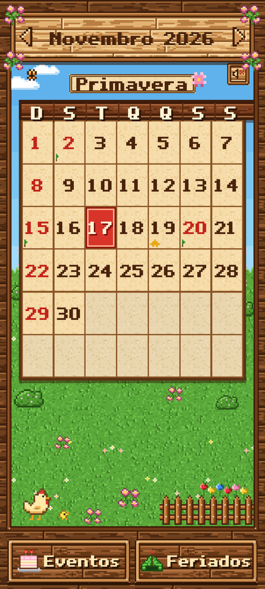
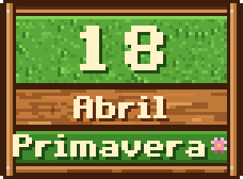

# 🌾 FarmDays — calendário em pixel art

Calendário Android com visual rural em pixel art: placa de madeira, céu com nuvens,
jardim com galinha, flores e cerca. Mostra o calendário **gregoriano real**, a
**estação do ano (hemisfério sul)**, seus **eventos** e os **feriados brasileiros**,
e tem um **widget nativo** para a tela inicial.

<p align="center">
  
  &nbsp;
  
</p>

## ⬇️ Baixar o APK

1. Abra a aba **Actions** do repositório → workflow **Android APK** → execução mais recente com ✅.
2. Em **Artifacts**, baixe `FarmDays-v1.0.0-apk` (um .zip com o APK dentro).
3. No celular, abra o `.apk` e permita "instalar apps desconhecidos" para o seu gerenciador de arquivos.

Quando uma tag `v*` é criada (ex.: `v1.0.0`), o mesmo workflow publica o APK em **Releases**.

> No Redmi/MIUI/HyperOS: para o widget, segure numa área vazia da tela inicial →
> **Widgets** → **FarmDays**. Se a data do widget demorar para virar à meia-noite,
> desative a otimização de bateria do app (Configurações → Apps → FarmDays → Economia de bateria → Sem restrições).

## ✨ Funcionalidades

| Área | O que faz |
|---|---|
| Calendário | Gregoriano real via `Date` do JavaScript (nenhum mês cadastrado à mão), semana começando no domingo (D S T Q Q S S), bissextos automáticos, abre sempre no mês atual, navegação por setas, deslize lateral e seletor de mês/ano (toque no título). Anos a partir de 2026. |
| Hoje | Destacado em vermelho; atualiza sozinho à meia-noite, ao voltar do segundo plano e se o fuso/horário mudar. |
| Estações | Hemisfério sul com início pelos **equinócios e solstícios astronômicos** (algoritmo de Meeus), convertidos para a data local. A decoração muda por estação (flores rosas na primavera, girassóis no verão, folhas caindo no outono, flores lilás no inverno). |
| Eventos | Criar, editar, excluir; nome, data, horário opcional e descrição; ver eventos do dia (toque no dia), por mês ou próximos. Salvos com `@capacitor/preferences` (SharedPreferences nativo) + cópia em `localStorage`. |
| Feriados | Feriados nacionais, pontos facultativos e datas comemorativas **separados**; visão por mês ou ano. 2026 conforme a Portaria MGI nº 11.460/2025; para anos sem portaria, os pontos facultativos aparecem como **previsão**. |
| Widget | `AppWidgetProvider` nativo (Java): placa de madeira, dia em destaque sobre fundo verde, mês, estação e florzinha. Atualiza à meia-noite (AlarmManager), quando data/fuso mudam e a cada 30 min como garantia. Toque abre o app. |
| Extras | Borboletas ocasionais, flores balançando, galinha que bica (toque nela!), nuvens, sons 8-bit **opcionais e desligados por padrão** (botão do alto-falante). Respeita "reduzir animações" do sistema. |

Todos os gráficos e a fonte pixel **FarmPixel** são originais deste projeto
(gerados por `tools/build_font.py` e `tools/build_assets.py`). Nenhum recurso de
Stardew Valley ou de outro jogo foi usado.

## 🗂️ Estrutura

```
www/                     App web (HTML/CSS/JS puro, sem bundler)
  index.html
  css/style.css          Estilo pixel art (escala por --u)
  js/calendar.js         Lógica do calendário gregoriano (testada)
  js/seasons.js          Estações astronômicas, hemisfério sul (testada)
  js/holidays.js         Feriados BR + estrutura p/ estaduais/municipais (testada)
  js/storage.js          Persistência (Preferences + localStorage)
  js/panels.js           Painéis: dia, eventos, formulário, feriados, seletor
  js/decor.js            Animações e decoração por estação
  js/sound.js            Sons opcionais (Web Audio)
  js/app.js              Tela principal
  assets/  fonts/        Sprites, texturas e fonte (gerados)
native/android/          Widget nativo e recursos Android
  java/                  FarmDaysWidget, WidgetRenderer, Seasons
  res/                   layout, xml do widget, ícones, strings
scripts/                 apply-native.mjs, prepare-android.mjs
tools/                   Geradores da fonte e do pixel art (Python + Pillow/fontTools)
tests/                   Testes (node --test)
.github/workflows/       Compilação automática do APK
```

A pasta `android/` **não é versionada**: ela é gerada pelo Capacitor e recebe o
widget, ícones e splash pelo `scripts/apply-native.mjs`. Assim o projeto nativo
sempre corresponde à versão do Capacitor instalada.

## 🛠️ Desenvolvimento local

Requisitos: Node.js 22+, JDK 21 e Android Studio (Otter 2025.2.1+ com SDK 36).

```bash
npm install
npm test                    # calendário, feriados, estações
npm run serve               # abre www/ em http://localhost:8080
npm run android:prepare     # cria/atualiza android/ com o widget
npm run android:open        # abre no Android Studio
npm run android:debug       # gera android/app/build/outputs/apk/debug/app-debug.apk
```

Para regenerar gráficos/fonte depois de editar os desenhos: `npm run assets`
(requer Python 3 com `Pillow` e `fontTools`).

## 🇧🇷 Feriados estaduais e municipais (futuro)

Em `www/js/holidays.js`, preencha `REGIONAL` com dados oficiais:

```js
REGIONAL.estados['SP'] = [{ m: 7, d: 9, name: 'Revolução Constitucionalista', source: 'Lei estadual ...' }];
REGIONAL.municipios['SP/São Paulo'] = [{ m: 1, d: 25, name: 'Aniversário de São Paulo', source: 'Lei municipal ...' }];
```

e chame `FarmHolidays.forYear(ano, { uf: 'SP', municipio: 'SP/São Paulo' })`.
Para cada novo ano, adicione a portaria federal em `OFFICIAL` (pontos facultativos
oficiais substituem a previsão automaticamente).

## 🔐 Versão de produção assinada (opcional)

O APK de depuração não precisa de chave. Para gerar também um APK assinado,
crie uma keystore **no seu computador** e cadastre em
*Settings → Secrets and variables → Actions*:

| Secret | Conteúdo |
|---|---|
| `ANDROID_KEYSTORE_BASE64` | arquivo `.jks` em base64 (`base64 -w0 farmdays.jks`) |
| `ANDROID_KEYSTORE_PASSWORD` | senha da keystore |
| `ANDROID_KEY_ALIAS` | alias da chave |
| `ANDROID_KEY_PASSWORD` | senha da chave |

```bash
keytool -genkeypair -v -keystore farmdays.jks -alias farmdays -keyalg RSA -keysize 2048 -validity 10000
```

Nenhuma senha ou chave fica no repositório. Sem os secrets, o workflow apenas pula essa etapa.

## Licença

MIT — veja [LICENSE](LICENSE).
